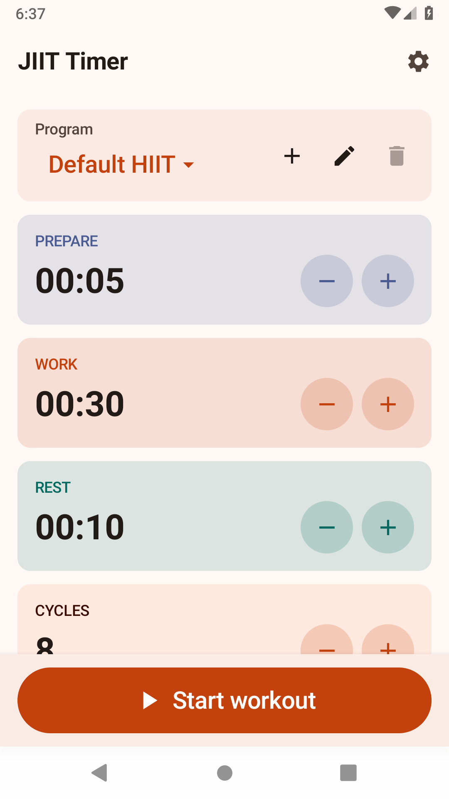
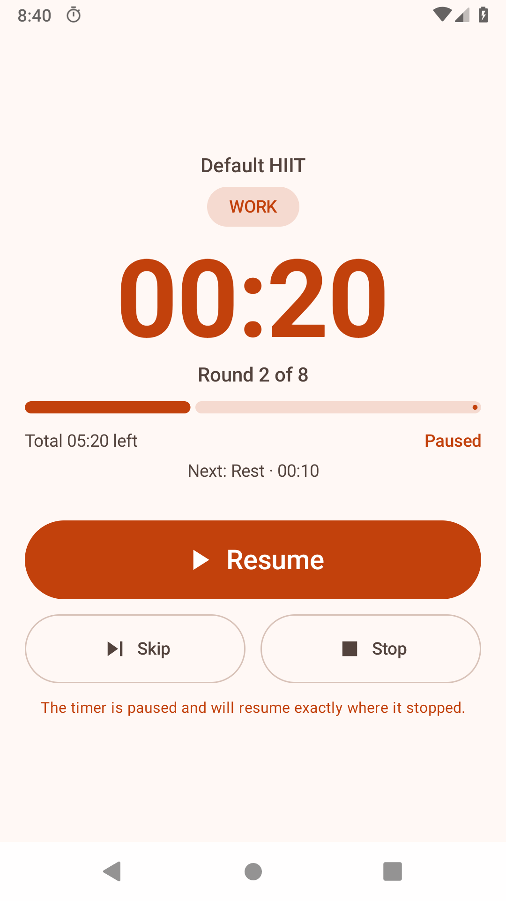

# JIIT Timer

A HIIT timer for Android, rewritten from the 2018 Java project to a modern Kotlin and Jetpack Compose stack.

The app lets you configure workout programs (prepare, work, rest, rounds and cool down), save them, run sessions with pause and skip controls, and keep the timer alive in the background with a persistent notification and actions.

| Setup | Workout paused |
|---|---|
|  |  |

## Features

- Reusable programs with unique names: create, rename, delete and switch programs.
- Configurable timings with safe limits: prepare, work, rest, rounds and cool down.
- Rest is scheduled only between rounds, never after the last one.
- Session total calculated in real time.
- Timer engine based on `SystemClock.elapsedRealtime()`: no drift from accumulated ticks, and catch-up when the main thread is delayed.
- Pause, resume, skip interval, stop and repeat a workout.
- Completion screen with the actual total duration.
- Foreground service with a persistent notification and actions (pause, resume, skip, stop).
- Partial wake lock during a session and `FLAG_KEEP_SCREEN_ON` while the UI is visible.
- Sound cues through `SoundPool`, transient audio focus, and distinct vibration patterns for work, rest and finish.
- Persisted sound and vibration settings.
- Material 3 light/dark theme and responsive layouts for portrait, landscape and wide screens.
- English and Spanish UI, accessible content descriptions and stable test tags.
- Automatic migration of programs from the old `SharedPreferences`/JSON format.
- DataStore persistence with versioned JSON; corrupt data falls back to defaults instead of breaking startup.

## Stack

| Component | Version |
|---|---|
| Kotlin | 2.2.21 |
| Android Gradle Plugin | 8.13.2 |
| Gradle | 8.13 |
| JDK | 17 or 21 (tested with 21) |
| compileSdk / targetSdk | 36 |
| minSdk | 24 |
| Jetpack Compose | BOM 2025.10.01, Material 3 |
| Persistence | DataStore Preferences + kotlinx.serialization |
| Concurrency | Coroutines + StateFlow |
| Tests | JUnit4, Truth, kotlinx-coroutines-test, Compose UI Test |
| CI | GitHub Actions |

## Architecture

```text
MainActivity
  └── JiitTimerAppScreen (Compose)
        └── MainViewModel
              ├── ProgramRepository ── DataStore (programs + settings)
              └── TimerEngine ── StateFlow<TimerState>
                    ├── WorkoutTimeline (prepare → work → rest → … → cooldown)
                    ├── WorkoutCuePlayer (SoundPool + vibration)
                    └── WorkoutTimerService (foreground service + notification + wake lock)
```

Key points:

- `TimerEngine` is pure Kotlin with no Android dependencies and is tested with a virtual clock. It derives everything from absolute elapsed time instead of accumulating ticks.
- The session lives in the application process, not in the Activity. Rotating the screen or closing the UI does not stop the workout.
- `WorkoutTimerService` only promotes the process to the foreground, publishes the notification and keeps the CPU awake. Notification actions send commands to the engine.
- `ProgramRepository` is the single source of truth for programs. Every change is reflected in memory immediately and serialized through a single writer.
- `ProgramsCodec` validates and normalizes everything it reads. If the JSON is corrupt, the repository tries the legacy format and then falls back to the default program. A bad field can no longer make the app unusable.
- The setup screen uses a compact primary-colored program header, a separate "Workout settings" section for the interval cards, and a fixed start button.

### Migration from 1.0

On first launch, if DataStore is empty, the old file is read:

```text
SharedPreferences: com.profesorfalken.jiittimer.JiitWorkoutData
Key: WorkoutsData
Format: [{"Title":"Default","Data":"30|10|60|3"}]
```

Each row is validated independently. Malformed rows are skipped, duplicate names are renamed, and out-of-range values are clamped. Migrated programs receive 5 seconds of prepare time, which the old model did not have.

## Build

Requirements:

- JDK 17 or 21.
- Android SDK with `platforms;android-36` and `build-tools;36.0.0`.
- `local.properties` with `sdk.dir=/path/to/Android/Sdk` (or `ANDROID_HOME` set).

```bash
./gradlew assembleDebug
```

Debug APK:

```text
app/build/outputs/apk/debug/app-debug.apk
```

The debug `applicationId` has a `.debug` suffix, so it can coexist with the release build. For release:

```bash
./gradlew assembleRelease
```

The release build applies R8 and `shrinkResources`. The resulting APK is unsigned; configure a release keystore before distributing it.

## Tests and quality

```bash
./gradlew testDebugUnitTest         # time logic, timeline, codec, migration and formatting
./gradlew connectedDebugAndroidTest # Compose flow on an emulator/device
./gradlew lintDebug                 # Android Lint
./gradlew assembleRelease           # R8 + shrinkResources
```

The unit suite covers:

- Time formatting and countdown rounding.
- Timeline construction and interval boundaries.
- Engine counting, pause, resume, skip, stop and finish.
- Interval cues and the 3-2-1 countdown.
- Legacy migration code, including corrupt and duplicated data.
- Versioned serialization, unknown-field tolerance and ID repair.

The instrumented tests verify that the setup screen appears, that a workout starts and resets, that a new program can be created from the UI, and that a short workout reaches the completion screen.

CI: [`.github/workflows/android.yml`](.github/workflows/android.yml) builds, runs the unit tests, runs lint and uploads the APK. Instrumented tests are run locally with an emulator or connected device.

## Project layout

```text
app/src/main/java/com/profesorfalken/jiittimer/
├── MainActivity.kt
├── JiitTimerApp.kt              # Application + AppContainer + notification channel
├── data/
│   ├── ProgramRepository.kt     # source of truth + DataStore
│   ├── ProgramsCodec.kt         # versioned JSON and validation
│   └── LegacyWorkoutParser.kt   # migration from the 2018 format
├── model/
│   ├── WorkoutProgram.kt
│   ├── UserSettings.kt
│   └── TimeFormat.kt
├── timer/
│   ├── TimerEngine.kt
│   ├── TimerState.kt
│   ├── WorkoutTimeline.kt
│   └── WorkoutCuePlayer.kt
├── audio/
│   └── AndroidCuePlayer.kt
├── service/
│   └── WorkoutTimerService.kt
└── ui/
    ├── MainScreen.kt
    ├── MainViewModel.kt
    └── theme/
```

## Permissions

- `POST_NOTIFICATIONS` (Android 13+): requested when the first workout starts. If denied, the service still runs but the notification may not appear in the drawer.
- `FOREGROUND_SERVICE` and `FOREGROUND_SERVICE_SPECIAL_USE`: a `specialUse` foreground service for a workout timer.
- `WAKE_LOCK`: keeps the CPU awake during a session.
- `VIBRATE`: haptic cues.

The app does not use the network, does not request location or storage permissions, and does not send data to any server.

## Verification

State verified during this modernization (November 11, 2026):

- `./gradlew assembleDebug`: passed.
- `./gradlew testDebugUnitTest`: 34 tests passed (time logic, timeline, engine, migration, codec, formatting and a Robolectric Activity smoke test).
- `./gradlew lintDebug`: 0 errors and 0 warnings.
- `./gradlew assembleRelease`: passed with R8 and resource shrinking.
- Manual test on an API 28 emulator: launch, workout start, pause, skip interval, resume, stop, persistent notification and service cleanup.
- `./gradlew connectedDebugAndroidTest`: 3/3 tests passed on an API 28 emulator (details in [`docs/VERIFICATION.md`](docs/VERIFICATION.md)).
- GitHub Actions CI: build, unit tests and lint passed on both `master` and `modernize/kotlin-compose`.

## Known limitations

- An active session is not restored if the process is fully killed; the foreground service and wake lock are intended to prevent that during normal use.
- The current model supports one work duration and one rest duration per program. It does not include exercise sequences, history or statistics.
- The release APK produced by CI is not signed.
- Publishing to Google Play requires declaring the `specialUse` foreground service in the app listing.
- No license is defined in the repository yet; add one before redistributing.
